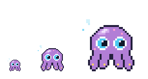
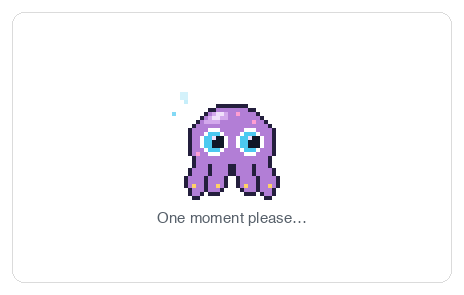
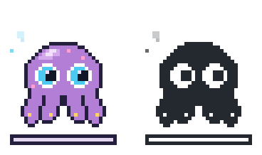
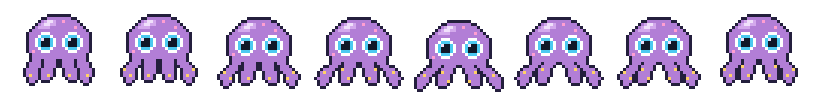
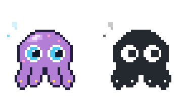

<div align="center">

# 🐙 octoloader

**A pixel-art octopus that swims while you wait.**

[](#footprint)
[](#react)
[](package.json)
[](https://github.com/michalstrnadel/octoloader/actions/workflows/ci.yml)
[](LICENSE)

React component · custom element · colour and monochrome · determinate and indeterminate

<picture>
  <source media="(prefers-color-scheme: dark)" srcset="docs/hero-dark.gif">
  
</picture>

</div>

---

Five hand-drawn 30×24 arm poses played as an eight-frame swim, a body that
lifts and settles across the cycle, a blink, a glance, and a trail of bubbles —
each on a clock of its own. No dependencies, no canvas, no GIF. The sprite is
plain SVG paths, so it stays crisp at any size and follows `currentColor` in
the monochrome variant.

The behaviour follows [Primer's loading pattern][primer]: nothing at all under
a second, an indeterminate swim from one to three, a determinate bar past
three.

[primer]: https://primer.style/product/ui-patterns/loading/

```sh
npm install github:michalstrnadel/octoloader
```

Installing from the repository builds `dist` on the way in, so it works
before the package has a registry entry.

## React

```jsx
import { OctoLoader } from 'octoloader';

<OctoLoader />
<OctoLoader variant="mono" label="One moment please…" />
<OctoLoader delay={1000} announce="Loading pull requests" />
<OctoLoader progress={0.62} label="Uploading…" />
<OctoLoader frame />
<OctoLoader size={90} speed={1.5} label={null} bubbles={false} />
```

| Prop                                           | Type                | Default                |                                                                                                             |
| ---------------------------------------------- | ------------------- | ---------------------- | ----------------------------------------------------------------------------------------------------------- |
| `variant`                                      | `'color' \| 'mono'` | `'color'`              | `mono` follows `currentColor`, with the eyes and suckers on `--octo-paper` and the pupils on `--octo-pupil` |
| `label`                                        | `ReactNode`         | `'One moment please…'` | `null` renders the sprite on its own                                                                        |
| `size`                                         | `number`            | `60`                   | Width in px. The sprite is 30 pixels wide, so multiples of 30 keep every pixel square                       |
| `speed`                                        | `number`            | `1`                    | Multiplier on every clock                                                                                   |
| `delay`                                        | `number`            | `0`                    | Milliseconds to stay invisible. Renders nothing at all until it elapses                                     |
| `progress`                                     | `number`            | —                      | `0`–`1` turns the loader determinate and draws a bar underneath                                             |
| `bubbles`                                      | `boolean`           | `true`                 | Bubbles drifting up past the animal's left side. Adds headroom above it                                     |
| `frame`                                        | `boolean`           | `false`                | Wraps it in an empty-state panel. Spans its container; give it a `maxWidth` to hold it in                   |
| `announce`                                     | `string`            | —                      | Overrides the accessible name. Without it the visible label is the name                                     |
| `className`, `style`, `id`, `data-*`, handlers |                     |                        | Anything a `div` takes, spread onto the wrapper                                                             |

The wrapper is an inline flex column and sets no colour of its own, so the
label and the `mono` sprite both take the surrounding text colour.

It forwards a `ref` to that wrapper and passes through anything else a `div`
accepts, so it drops into a design system without a wrapper of your own:

```tsx
const ref = useRef<HTMLDivElement>(null);
<OctoLoader ref={ref} id="pending" data-testid="loader" className="my-loader" />;
```

The attributes it works out for itself — `role`, `aria-label`,
`aria-labelledby` and the `aria-value*` trio — are removed from the prop type
rather than silently overwritten, so passing `aria-label` is a type error that
points you at `announce`.

<picture>
  <source media="(prefers-color-scheme: dark)" srcset="docs/sizes-dark.png">
  
</picture>

`size` 30, 60 and 120. Every pixel stays square because each is a multiple of
the sprite's own 30.

## Without React

```html
<script type="module">
  import 'octoloader/element';
</script>

<octo-loader variant="mono" size="60" label="One moment please…"></octo-loader>
<octo-loader delay="1000" progress="0.4"></octo-loader>
<octo-loader frame></octo-loader>
```

The custom element takes the same options as attributes and renders into a
shadow root, so nothing on the page can style it by accident. `progress` is
whatever `Number()` makes of it; leave the attribute off for the indeterminate
swim.

Every option is a property too, because half the frameworks that consume a
custom element bind properties and never call `setAttribute`. Each accessor
reads and writes the attribute, so the two cannot disagree — there is one piece
of state and it lives in the DOM.

```js
const loader = document.querySelector('octo-loader');
loader.variant = 'mono';
loader.progress = done / total; // null for indeterminate
loader.frame = true;
```

TypeScript knows the tag, so `document.querySelector('octo-loader')` comes back
as an `OctoLoaderElement` rather than an `Element`.

## In an empty state

A loader on its own floats. `frame` puts it in the panel an empty state
usually occupies — a hairline border, a radius and room to breathe.

<picture>
  <source media="(prefers-color-scheme: dark)" srcset="docs/frame-dark.gif">
  
</picture>

```jsx
<OctoLoader frame />
<OctoLoader frame style={{ maxWidth: 420 }} />
```

The panel spans its container rather than hugging the octopus, because a box
drawn tight around the content reads as a badge instead of as the space
something is about to appear in. Give it a `maxWidth` when you want it small.

The border is one neutral grey at low alpha rather than `currentColor`, so a
single value holds on a light page and a dark one — the same reasoning as the
three-tone face. Two variables move it:

```css
.loader {
  --octo-frame: rgba(0, 0, 0, 0.12);
  --octo-frame-radius: 12px;
}
```

## Matching the wait

An indicator is not free. One that appears for 200ms and vanishes reads as a
glitch; one that spins with no end in sight reads as a hang. [Primer][primer]
sets four windows, and the props map onto them:

| Wait     | What to show                   | How                                        |
| -------- | ------------------------------ | ------------------------------------------ |
| under 1s | nothing                        | `delay={1000}`                             |
| 1–3s     | indeterminate                  | `<OctoLoader delay={1000} />`              |
| 3–10s    | determinate, if you can        | `<OctoLoader progress={done / total} />`   |
| over 10s | determinate, and stop blocking | `progress`, plus let people leave the page |

<picture>
  <source media="(prefers-color-scheme: dark)" srcset="docs/progress-dark.gif">
  
</picture>

`delay` is the one worth wiring up everywhere. Most requests come back fast,
and a loader that only appears when the wait turns out to be real is the
difference between a page that feels quick and one that flickers.

Two things it cannot do for you:

- **Reserve the space.** While the delay runs the component renders `null`, so
  give its slot a `min-height` if the content around it would otherwise jump.
- **Hold itself open.** Once it is up, unmounting it 80ms later flashes just as
  badly. Keep it mounted for a floor of ~400ms in the state that owns it.

## How it moves

Five arm poses played out and back, with the inner arm running a step behind
the outer one — that lag is what turns two waving limbs into one travelling
wave:

```
frame   1     2     3     4     5     6     7     8
pose    0     1     2     3     4     3     2     1
lift    0px   0px   1px   1px   2px   1px   1px   0px
```

<picture>
  <source media="(prefers-color-scheme: dark)" srcset="docs/frames-dark.png">
  
</picture>

The lift is the part that matters. The whole animal rises as its arms draw in
and settles as they spread, the way an octopus jets. Take it away and eight
frames still read as a flipbook.

Both halves of that are easy to get wrong in ways that look like a twitch
rather than a bug, so both are pinned by tests:

- **The poses are drawn, not interpolated.** Tweening between two poses a pixel
  apart collapses on rounding — five steps become three drawings, and two pairs
  of frames hold still while the body keeps moving.
- **The height belongs to the pose, not the frame number.** Put the same pose at
  two different heights on the way out and the way back and the loop stutters
  while every frame is individually correct.

Four kinds of clock run at once, and none of them line up:

| Sequence | Period           | What it does                                 |
| -------- | ---------------- | -------------------------------------------- |
| swim     | 0.9s             | the eight-frame arm cycle and the lift       |
| blink    | 4.6s             | eyes shut for 115ms                          |
| glance   | 7.3s             | pupils one pixel left, later one pixel right |
| bubbles  | 2.6s, 3.2s, 3.8s | three bubbles drifting up past its left side |

Those periods share no factor on purpose, so nobody watching a loading screen
ever sees the whole pattern come round.

## How it is put together

The frames sit side by side in one long strip, and the strip slides under the
viewBox a frame at a time under `steps()`. The obvious alternative — stacking
the frames and cross-fading their opacity — needs one animation per frame per
expression, which on a page with several loaders runs into the hundreds and
shows up as dropped frames. This is eight animations no matter how many
drawings there are, and a frame is never half-swapped.

Because the viewBox never moves, the eyes can sit outside the strip: one set of
eyelids and pupils covers whichever frame is showing.

The determinate bar is drawn on the same grid — 28 whole pixels, so it advances
in visible steps rather than creeping a subpixel at a time — and it sits
outside the group the reduced-motion pulse applies to, so a bar that is at 40%
stays at 40%.

## The monochrome variant is three tones, not two

<picture>
  <source media="(prefers-color-scheme: dark)" srcset="docs/variants-dark.gif">
  
</picture>

The obvious monochrome is one ink with the eyes punched out. It looks correct
on a white page and turns into a skull on a black one — the body goes light,
the punched eyes go dark with the background, and you are looking at sockets.

So only the body follows `currentColor`. The eyes and suckers sit on
`--octo-paper` (default `#f6f8fa`) and the pupils on `--octo-pupil` (default
`#1b1f24`). Holding the eye lighter than the body and the pupil darker than the
eye keeps the face reading the same way on either ground, and one sprite covers
both. Override the two variables if your surface needs it.

The determinate bar is built from the same three: the frame is `currentColor`,
the track is paper and the fill is pupil. Collapse any two of those and the bar
stops carrying the number — paint the track in the ink and the whole thing is
one block, paint the fill in the ink too and there is nothing left to read. A
test holds all three apart in both palettes.

```css
.loader {
  color: #1b1f24;
  --octo-paper: #f6f8fa;
  --octo-pupil: #0d1117;
}
```

## Accessibility

The sprite is `aria-hidden`, so nothing gets announced twice. The wrapper does
the talking, and what it is depends on whether you handed it a `progress`:

|               | Role                                              | Name                                            |
| ------------- | ------------------------------------------------- | ----------------------------------------------- |
| indeterminate | `role="status"`                                   | `aria-labelledby` pointing at the visible label |
| determinate   | `role="progressbar"` with `aria-valuenow/min/max` | the same                                        |

Naming the region from the text people can actually see is Primer's
preference, and it keeps the two from drifting apart. Pass `announce` when the
spoken name should differ — `announce="Loading status checks"` is more use than
"One moment please…" read aloud. With no visible label and no `announce`, the
name falls back to "Loading". The custom element spells the name out in
`aria-label` instead, because `aria-labelledby` cannot reach across a shadow
boundary.

Two things belong on your side of the boundary, not in here:

```jsx
<section aria-busy={pending}>
  {pending ? <OctoLoader delay={1000} /> : <Results items={items} />}
</section>
```

- `aria-busy` goes on the region whose content is being replaced, not on the
  loader. The loader is the thing that appeared; the section is the thing that
  is stale.
- Move focus to the first focusable element in the new content once it lands,
  or to the error message if it fails.

Under `prefers-reduced-motion: reduce` the swim, the blink, the glance and the
bubbles all stop, and the octopus fades gently in place instead. It keeps
moving on purpose — Primer asks for loading animation to stay subtle rather
than stop, because a frozen indicator is indistinguishable from a hung one —
but nothing travels across the screen.

## Footprint

| Entry                | Gzipped |
| -------------------- | ------- |
| `octoloader` (React) | 4.8 kB  |
| `octoloader/element` | 5.2 kB  |

One stylesheet, however many loaders. It is rendered as a hoisted `<style>`,
so React 19 lifts it into `<head>` and de-duplicates it across every instance
on the page; on React 17 and 18 each instance carries its own copy, which is
harmless because SVG styles are document-global either way.

The component is wrapped in `memo`, so a loader inside a component that
re-renders on every keystroke does not re-reconcile its twenty-odd SVG nodes.

No runtime dependencies. React is an optional peer, so importing
`octoloader/element` on a page with no React pulls in nothing extra.

## Browser support

Anything that understands CSS custom properties, `steps()` timing and
`prefers-reduced-motion` — Chrome, Edge, Firefox and Safari from 2020 onward.
There is no polyfill and no fallback path, because there is nothing to fall
back to: without the animation you have a still octopus, which still says
"waiting".

`<octo-loader>` additionally needs custom elements and shadow DOM, the same
vintage. The React entry needs none of that.

## Editing the octopus

`src/sprite.ts` is the drawing. Each frame is an array of strings, one
character per pixel:

```
'.....obbbwcccwbbbbwcccwbbbo.....'
```

`.` transparent, `o` outline, `b` body, `h`/`H` highlight, `s` shadow,
`w` eye white, `c` iris, `p` pupil, `g` sucker, `k` sparkle. Change a
character, change the octopus — the renderer collapses runs of the same
character into one SVG path per colour at import time, so there is no build
step between you and the pixels.

Recolouring is `COLOR_PALETTE`, also in `src/sprite.ts`. Add a character to the
palette and it becomes drawable. The suckers are the clearest example of a
character earning its keep: gold dots in colour, paper dots in mono, and
without them the arms read as a solid lump at 30 pixels wide. Three entries are
not sprite characters at all — `B` is the bubbles, `T` the progress track and
`F` the progress fill.

`FRAME_BLINK`, `FRAME_LOOK_LEFT` and `FRAME_LOOK_RIGHT` are stored as whole
frames and reduced to a patch over the eye band at import time, so each
expression stays editable as a complete picture while the DOM only carries what
changed. The bubbles are in `BUBBLES` — position, size, distance and period,
four numbers each.

The test suite guards the drawing, not just the code: every frame has to be a
full rectangle, use only characters both palettes know, and contain no
background pixel sealed inside the silhouette. That last one catches the stray
hole that is invisible at 12× and reads as dirt at 1×.

Other tests hold the shape of the animation: no frame may repeat inside a
cycle, the arms have to sweep out and back rather than loop one way, a pose has
to keep its height, and the monochrome palette has to resolve to three tones —
collapsing it back to two is exactly the change that looks fine in light mode
and breaks dark.

## Development

```sh
npm install
npm test
npm run typecheck
npm run build
npx serve .          # then open /demo/
```

`demo/index.html` loads `dist/element.js` as a module, so it needs a server —
browsers refuse module imports over `file://`.

See [CONTRIBUTING.md](CONTRIBUTING.md) before opening a pull request, and
[CHANGELOG.md](CHANGELOG.md) for what has changed.

## Licence

MIT © Michal Strnadel. The octopus is from an original illustration; the pixel
sprite is part of this package and carries the same licence.
